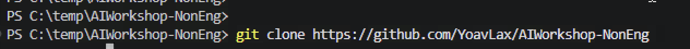
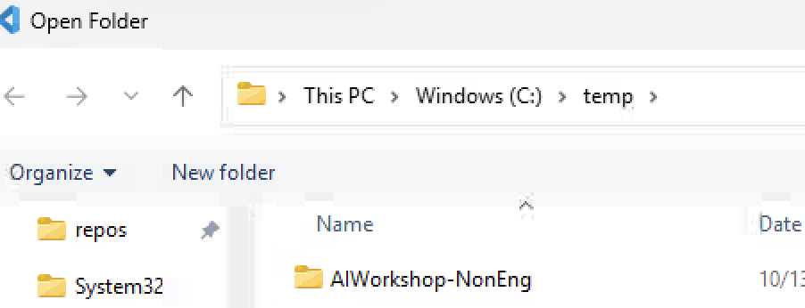
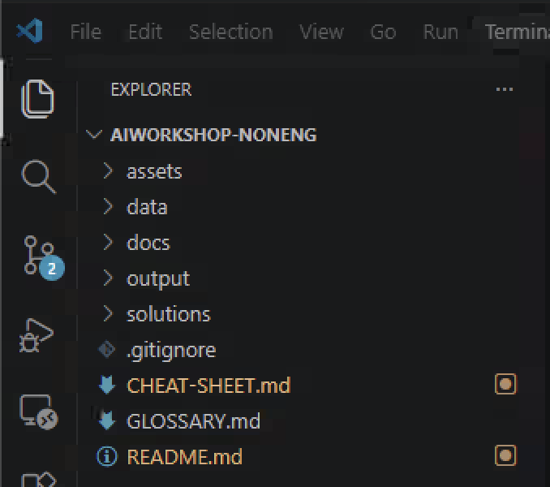
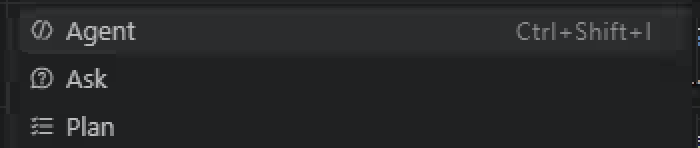
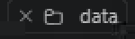

# GitHub Copilot for People & Culture (and other non-technical teams)

A hands-on workshop for people who **do not write code**: HR, Recruiting, Finance, Ops, Legal, Marketing, and anyone who works with documents, spreadsheets and reports.

You will use GitHub Copilot as a **work assistant**: ask questions about policies, clean up messy spreadsheets, draft documents, and build interactive dashboards from CSV files, without writing a line of code yourself.

> **Time:** about 4 hours (with a break) | **Level:** beginner | **Coding experience needed:** none

## What you will be able to do afterwards

- Explain what AI can and cannot do, and why it sometimes gets things wrong.
- Write prompts that work the first time (**Goal / Context / Format / Rules**).
- Use **Ask**, **Plan** and **Agent** modes, and know when to use which.
- Turn a messy spreadsheet into a clean one, and an HR CSV into a working HTML dashboard.
- Teach Copilot your team's rules once, using **instructions**, **prompt files**, **agents** and **skills**.
- Run several tasks in parallel in the **GitHub Copilot app**.
- Use AI responsibly with employee data.

## Agenda

| # | Module | Time |
|---|--------|------|
| 0 | [Setup and tour](#module-0-setup-and-tour-10-min) | 10 min |
| 1 | [AI foundations](#module-1-ai-foundations-20-min) | 20 min |
| 2 | [Ask mode: documents and policies](#module-2-ask-mode-documents-and-policies-25-min) | 25 min |
| 3 | [Agent mode: let Copilot do the work](#module-3-agent-mode-let-copilot-do-the-work-35-min) | 35 min |
| | *Break* | 10 min |
| 4 | [Dashboards: from CSV to a working web page](#module-4-dashboards-from-csv-to-a-working-web-page-60-min) | 60 min |
| 5 | [Teach Copilot your way of working](#module-5-teach-copilot-your-way-of-working-40-min) | 40 min |
| 6 | [The GitHub Copilot app](#module-6-the-github-copilot-app-25-min) | 25 min |
| 7 | [Responsible AI and wrap-up](#module-7-responsible-ai-and-wrap-up-20-min) | 20 min |

Keep [CHEAT-SHEET.md](CHEAT-SHEET.md) open all day. Unknown word? See [GLOSSARY.md](GLOSSARY.md).

## Prerequisites

| Required | Why |
|----------|-----|
| A **GitHub account** with a **Copilot** licence | Copilot needs it to sign in |
| **[Visual Studio Code](https://code.visualstudio.com/)** + the **GitHub Copilot** extension (Chat is included) | The editor where Copilot lives |
| **[Git](https://git-scm.com/downloads)** | An "undo history" for everything Copilot changes |
| **GitHub Copilot app** (link from your facilitator) | Used in Module 6 |
| Excel, Google Sheets or similar | To double-check Copilot's numbers |
| A web browser | To open the dashboards you build |

Optional: the **Live Preview** extension (Microsoft) for VS Code, so dashboards can load the CSV automatically.

**You do NOT need:** Node.js, Python, Docker, a terminal, or any programming knowledge.

## What is in this repository

| Folder / file | Purpose |
|---------------|---------|
| `data/` | Practice data. **Fictional**: 240 employees of the made-up company "Brightwave Co." |
| `docs/` | Practice documents: policies, a job ad, review notes, a welcome-email template (all fictional) |
| `assets/` | A wireframe image and the chart library used by the dashboards |
| `output/` | **Everything Copilot creates for you goes here.** Starts empty. |
| `solutions/` | Reference answers. Peek only if you are stuck ([details](solutions/README.md)) |
| `_facilitator/` | For the person running the workshop (contains the answers) |

## Four golden rules

1. **You are the author, Copilot is the assistant.** You are responsible for what goes out under your name.
2. **Never trust numbers you haven't checked.** Double-check in Excel.
3. **Be specific.** Say what you want, what it's for, what it should look like, and what the rules are.
4. **Real employee data stays out unless your company allows it.** Today everything is fictional; Module 7 covers the real-world rules.

---

## Module 0: Setup and tour (10 min)

**Goal:** a working chat and a feel for where things are.

1. Open **VS Code** and check you are signed in with GitHub (account icon, bottom of the left bar).
2. Press `Ctrl+Shift+P` (Mac `Cmd+Shift+P`) to open the **Command Palette** (the search box for every command). Type `Git: Clone` and press Enter. When it asks for the repository URL, paste exactly this and press Enter:

   ```
   https://github.com/YoavLax/AIWorkshop-NonEng.git
   ```

   (The `.git` at the end is optional; the address works without it too.) If you prefer a terminal, the same thing is done with `git clone` followed by the address:

   

   Then choose where to save it: create a **new, empty folder** for the workshop first (for example `Documents\AI-Workshop`) and select it. Best practice: keep each project in its own folder so nothing gets mixed up. When VS Code offers **Open**, click it, then choose **Yes, I trust the authors**.
3. Make sure `data`, `docs` and `output` are directly visible in the **Explorer** (left panel). If not, use **File > Open Folder** and pick the workshop folder (the one that contains `data`, `docs` and `output`). Copilot only reads your team's rules if this is the top-level folder.

   

   When it worked, the Explorer looks like this:

   
4. Open the chat with `Ctrl+Alt+I` (Mac `Ctrl+Cmd+I`), or click the **chat icon** (a speech bubble with sparkles) at the top of the window.

   

   Find the **mode picker** at the bottom of the chat box: a small drop-down button that currently says **Agent** or **Ask**. Click it to see the modes:

   

| Mode | In one sentence | Changes your files? |
|------|-----------------|---------------------|
| **Ask** | Answers questions, explains, drafts text in the chat | No |
| **Plan** | Thinks through the steps and asks you questions before anything is done | No |
| **Agent** | Does multi-step work: creates and edits files, checks its own work | **Yes** (visible and undoable) |

Also spot the **Source Control** icon (three circles joined by a branching line, third icon from the top of the left bar, see the Explorer screenshot above). A small number on it means files have changed. You will use it in Module 3.

**How to give Copilot a file (you will do this a lot).** Typing `#file:docs/some-file.md` as plain text is not always recognised. Use one of these instead:

- **Drag and drop:** drag the file or folder from the **Explorer** (left panel) into the chat box. This works every time.
- **Pick from the list:** type `#` in the chat box, choose **Files & Folders** (or start typing the file name) and click the file in the list.
- **Add Context button:** click the paperclip / **Add Context...** button in the chat box and choose the file.

When it worked, the file appears as a small label above or inside the chat box:



In this guide, `#file:...` and `#folder:...` mean "attach this file or folder in one of these ways".

**Checkpoint:** chat answers you, and you can switch between Ask, Plan and Agent.

| Problem | Fix |
|---------|-----|
| No chat icon / no Agent mode | Update VS Code (Help > Check for Updates) and sign in; ask the facilitator if your organisation disabled it |
| "No access to Copilot" | Your licence isn't assigned yet; tell the facilitator |
| Clone fails | Check you're signed in to GitHub in VS Code and have access to the repository |

---

## Module 1: AI foundations (20 min)

**Goal:** understand just enough about how AI works to use it well and to spot when it is wrong.

### 1.1 The mental model

Copilot is powered by a **large language model (LLM)**. Think of it as a very well-read colleague who:

- is excellent at **writing, summarising, rephrasing, structuring and spotting patterns**,
- **predicts the most likely helpful answer**; it doesn't look things up like a database,
- is **confident even when wrong**. Wrong answers sound as polished as right ones (this is a **hallucination**),
- knows **nothing about your company** unless you give it your files (**context**),
- **forgets** everything between chats unless you save instructions (Module 5).

| AI is great at | AI is risky at |
|----------------|----------------|
| Drafting and rewriting text | Facts about *your* company that you didn't provide |
| Summarising long documents | Exact arithmetic on big tables (it may "eyeball" it) |
| Cleaning and reformatting data | Dates, weekdays, names and numbers (always verify) |
| Explaining and brainstorming | Anything legal, medical, or a decision about a person |
| Building tools that do the maths (formulas, dashboards) | Knowing what is confidential |

> **Key idea for today: have AI build the calculator. Don't make AI be the calculator.** We let Copilot create a spreadsheet formula or a dashboard that computes numbers reliably, then we check the result.

If you want to see it for yourself, open a **new VS Code window with no folder** (**File > New Window**; Copilot can't see our workshop files there) and ask: "How many weeks of paid parental leave does Brightwave Co. give?". It has never seen our documents, but it will probably answer confidently anyway. Module 2 fixes this.

*Why a separate window?* In the workshop folder, Copilot may find `docs/parental-leave-policy.md` on its own and give a correct answer. That is also useful to know: **when Copilot can see your documents, it uses them; when it can't, it guesses.**

### 1.2 Vocabulary you will meet today

| Term | Plain meaning |
|------|---------------|
| **Agent** | An AI that can *do* steps: read your files, create files, fix its own mistakes |
| **Tools** | The things an agent is allowed to use (read a file, create a file...). You approve sensitive ones |
| **Context** | What the AI can see right now: your message, attached files, saved instructions |
| **Instructions / prompt files / agents / skills** | Saved know-how you give the AI once (Module 5) |
| **MCP** | A "plug" that connects Copilot to other systems such as Jira or an HR system. You don't need it today |

### 1.3 The prompt formula: Goal / Context / Format / Rules

| Part | Question it answers | Example |
|------|---------------------|---------|
| **Goal** | What do I want done? | "Summarise the attached policy" |
| **Context** | Who is it for? Based on what? | "for new managers; use only `#file:docs/remote-work-policy.md`" |
| **Format** | What should it look like? | "5 bullets and a one-line takeaway" |
| **Rules** | What must it do or avoid? | "Don't invent anything; say 'not in the policy' if unsure" |

Tips: talk to it like a smart new colleague who has never worked here; iterate ("shorter", "use a table", "what did you assume?"); add "if unclear, ask me up to 3 questions first"; start a **new chat** for a new topic.

### 1.4 Exercise: your own prompt (10 min)

**Your task:** pick one small writing task from your own week, for example a candidate rejection email, an announcement, or a policy explanation. Use **no real names or confidential data**.

1. Open a new chat in **Ask** mode.
2. Write your prompt using the four parts from 1.3. Example:
   ```
   Goal: Write a short rejection email to a candidate who interviewed for a Marketing role.
   Context: Friendly company, the candidate was strong but another person was a better fit.
   Format: Under 120 words, three short paragraphs, plain text.
   Rules: Don't promise a future role. Don't mention other candidates. Don't invent details.
   ```
3. Read the answer and send **two follow-up messages** to improve it (for example "make it warmer" and "shorter, 80 words").
4. Share your best result with a neighbour and say which follow-up helped most.

**Checkpoint:** you can name what AI is risky at, and you wrote a prompt with the four parts.

---

## Module 2: Ask mode, documents and policies (25 min)

**Goal:** use Copilot on documents, and make it **cite sources** and **admit when it doesn't know**. Mode: **Ask**. You will work with the fictional policies in `docs/`.

### 2.1 Policy Q&A with sources (10 min)

Open a new chat (Ask mode). First **attach the `docs` folder**: drag it from the Explorer into the chat box (see "How to give Copilot a file" in Module 0). Then send:

```
Using ONLY the attached files in the docs folder, answer: how many weeks of paid parental leave do employees get, and who is eligible?

Rules:
- Quote the exact sentence you rely on and name the file and section.
- If two documents disagree, show both and tell me they conflict.
- If the answer is not in the documents, say "I can't find this in our policies."
```

Compare with the confident answer from Module 1: same question, much better result, because it now has **context** and **rules**. Now ask these, and check each answer against the source file:

1. How many PTO days does an employee with 5 years of service get?
2. How many days per year can someone work from abroad?
3. What is the learning budget, and what happens if I leave soon after using it?
4. Do we reimburse gym memberships?

> **If it says it can't read the files:** the folder was probably not attached. Drag the `docs` folder into the chat again, check that it shows as a label in the chat box, and resend. If Copilot still doesn't read it, switch to **Agent** mode for this question; Agent can open files itself.

> **Spot the traps.** Question 2 hits a deliberate conflict between two policies. Question 4 isn't covered anywhere; a good answer says so. If Copilot invents a gym policy, you have just seen a hallucination in the wild.

### 2.2 Make a job ad inclusive (8 min)

Open `docs/job-description-draft.md` (a deliberately bad job ad), attach it to the chat (drag it in, or type `#` and pick the file), then send:

```
Review the attached job-description-draft.md for inclusive language.
1) List every phrase that could discourage qualified candidates (gendered, age-related, culture-fit, unnecessary requirements) and say why.
2) Rewrite the ad: same role, welcoming tone, skills-based requirements, under 300 words.
3) List the information that is missing and should be added (for example the pay range).
```

Did it catch everything? **You are the final reviewer.** Check the result against this list of problems planted in the ad:

- **Title and tone:** "Rockstar", "ninja", "work hard and play hard", "banter" (culture-fit, exclusionary slang).
- **Gendered words:** "He will be aggressive".
- **Age hints:** "young, energetic team", "recent graduate or digital native".
- **Unrealistic or contradictory requirements:** "entry-level" but "10+ years"; "top university".
- **Unnecessary or discriminatory requirements:** "native English speaker", "lift 50 lbs", "clean-cut appearance", "on call nights and weekends without notice".
- **Missing information:** pay range, benefits, working model, how decisions are made.

AI is not consistent: it will usually catch most items but may skip some (for example the title "Rockstar" or "digital native") or explain one wrongly. Tick off what it found and ask a follow-up for anything it missed: *"You did not mention X. Is that a problem? Update your list."*

### 2.3 Performance review notes: a careful use case (7 min)

Open `docs/performance-review-notes.md` (fictional manager notes about "Jamie Rivera"):

```
Turn #file:docs/performance-review-notes.md into a balanced, fact-based performance review summary.
Rules:
- Use only facts and examples that appear in the notes. Do not invent achievements.
- Flag wording that sounds biased, vague, or personal rather than about work.
- Flag anything that should NOT be part of a performance review (for example health or leave).
- Do not recommend a rating, promotion or pay decision.
```

This is AI as an **editor and second pair of eyes**, not a decision-maker.

*Quick ideas, no exercise needed:* ask for the same policy summarised for employees vs. managers, an FAQ for new joiners with source references, or quiz questions from the parental leave policy.

**Checkpoint:** you got cited answers, found the conflict, saw the "can't find this" answer, and produced an inclusive rewrite.

---

## Module 3: Agent mode, let Copilot do the work (35 min)

**Goal:** hand Copilot a multi-step task, review the result, and **undo** what you don't like. Mode: **Agent**.

**You stay in control:** the agent asks permission before sensitive actions, every change is visible and undoable, and it writes new files to `output/` so your originals in `data/` stay safe.

### 3.1 The task blueprint: Goal / Inputs / Output / Rules / When unsure

```
GOAL:        what you want done
INPUTS:      which files to use (#file:...)
OUTPUT:      what file(s) to create, where, and what they look like
RULES:       what to follow or avoid
WHEN UNSURE: what to do instead of guessing
```

### 3.2 Exercise: clean a messy spreadsheet (15 min)

`data/new_hires_messy.csv` looks like a real HR export: inconsistent dates, names in two orders, missing emails, "Support" vs. "Customer Support", duplicates. Spend one minute spotting problems, then switch to **Agent** mode, start a **new chat** and send:

```
GOAL: Clean the new-hire list so People Ops can use it.
INPUTS: #file:data/new_hires_messy.csv
OUTPUT: A new file output/new_hires_clean.csv (do not change the original) plus output/cleaning_report.md.
RULES:
- One row per person, "First Last" names in normal capitalisation.
- Dates in YYYY-MM-DD format. Today is 2026-09-30; all start dates are in the future.
- Department must be one of: Engineering, Sales, Customer Support, Marketing, Finance, Product, Operations, People & Culture, Legal.
- Emails in lower case. Locations as full city names (New York, Austin, London, Berlin, Toronto).
- Remove duplicate people and mention which rows you merged.
WHEN UNSURE: do not guess. Put the row in the report under "Needs a human decision" with the reason (for example a date that could be day/month or month/day, or a missing email).
```

> If Copilot says it needs Python or another program, reply: *"Please don't use any programs. Create the files directly."*

**Verify (don't skip):**

1. Open `output/new_hires_clean.csv` in Excel and count the rows. The original has more rows than unique people.
2. Compare 5 rows with the original.
3. Read the report: did it flag ambiguous dates and missing emails, or quietly guess?
4. Are all start dates **Mondays**? (AI often gets weekdays wrong.)

If something is off, reply in the same chat: "Row for X has the wrong department, fix it and update the report."

### 3.3 Exercise: batch welcome emails (7 min)

```
GOAL: Write a welcome email for every person in #file:output/new_hires_clean.csv.
INPUTS: the clean CSV and the template #file:docs/onboarding-welcome-template.md
OUTPUT: One file per person in output/welcome-emails/, named like "2026-10-19_imani-okonkwo.md".
RULES: Follow the template exactly. Fill in only the data in the CSV.
WHEN UNSURE: if a value is missing, write [TODO: ask People Ops for <field>]. Never invent a buddy, email or time.
```

Open a few emails. A *good* agent leaves `[TODO]` where data was missing instead of making things up.

### 3.4 Undo: your safety net (5 min)

1. **In the chat:** use **Undo / Discard** (and **Keep**) on the agent's last edit.
2. **Source Control panel:** lists every changed file; click one to see exactly what changed, or use the **Discard** arrow.
3. **Commit:** a named save point you can always return to. Open **Source Control**, type a message (e.g. `Clean new hire list and welcome emails`), click **Commit** (choose **Yes / Always** if asked to stage changes). If Git says it doesn't know who you are, ask Copilot *"Walk me through telling Git my name and email"*, or ask your facilitator.

> **Habit:** commit after every task that went well. It takes 10 seconds and you can't lose good work.

**Checkpoint:** `output/new_hires_clean.csv` and `output/cleaning_report.md` exist and you checked them; welcome emails exist with `[TODO]` where data was missing; you made a commit.

**Discuss:** what would have happened without "When unsure"? Which task in your team looks like this (many similar items, one template)?

---

## Module 4: Dashboards, from CSV to a working web page (60 min)

**Goal:** plan a dashboard with Copilot, build it with Agent mode, **verify the numbers**, then iterate. You end up with real, interactive HTML pages, with no coding.

**Why a dashboard instead of "ask the AI for the numbers"?** The page **calculates** the numbers from the CSV every time (the calculator). Copilot only writes the page (the builder). That is more reliable and repeatable (load next month's file and it updates), and your data stays on your computer.

**How they work:** a dashboard is **one `.html` file** in `output/`. Double-click it, press **Choose CSV file** and pick the CSV. It does **not contain the data**. Charts use the library in `assets/vendor/chart.umd.js` (no internet needed). With the Live Preview extension it can load the CSV automatically.

> **As-of date:** the sample data was exported on **2026-09-30**. Tell Copilot to treat that as "today", otherwise tenure and "last 90 days" numbers will differ from ours.

### 4.1 Plan first (10 min), mode: **Plan**

Never start building straight away. Switch to **Plan** and send:

```
I want an interactive HTML dashboard for our headcount, built from #file:data/employees.csv.
Audience: the People & Culture leadership team. As-of date: 2026-09-30.
Before proposing anything, look at the file, then ask me the questions you need to build it well.
Then propose: the KPI cards, the charts (with the chart type for each), the filters, and the exact definition of every KPI.
```

Answer its questions (for example: *"Active = no termination date."*), edit the plan, and move on once you agree with the **definitions**. Planning costs two minutes and saves twenty.

### 4.2 Build the headcount dashboard (15 min), mode: **Agent**

Switch to **Agent** (same chat, so it remembers the plan):

```
Build the dashboard we planned.
OUTPUT: one self-contained file output/headcount-dashboard.html (no internet needed). Use the local chart library via <script src="../assets/vendor/chart.umd.js"></script>.
RULES:
- The page does NOT contain data. It has a "Choose CSV file" button, also accepts drag and drop, and reads the CSV in the browser.
- Active employee = empty termination_date. As-of date 2026-09-30.
- A clear title, 4-5 KPI cards with a short definition under each, 3-5 charts, and filters.
- Clean, professional look; do not show salaries of individuals.
WHEN UNSURE: tell me your assumption instead of guessing silently.
```

Open `output/headcount-dashboard.html` in your browser, press **Choose CSV file** and select `data/employees.csv`.

**Verify like a pro (5 min):** check three numbers in Excel: **active employees** (empty `termination_date`), **headcount of one department**, and **new hires in the last 90 days** or **average tenure**. Does the dashboard's definition match yours?

> **Common mistake:** if it shows **240**, it counted people who already left. Tell Copilot: *"Headcount should exclude people with a termination date. Fix it and explain what was wrong."*

### 4.3 Vision: build from a sketch (10 min), mode: **Agent**

Open `assets/wireframe-recruiting-dashboard.png`, a rough sketch of a dashboard. **Attach the image** to the chat (drag it in, or use the paperclip / **Add Context > Image**) and send:

```
Build this recruiting dashboard from the attached wireframe, using #file:data/recruiting_pipeline.csv.
OUTPUT: output/recruiting-dashboard.html, one self-contained file, using ../assets/vendor/chart.umd.js, with a "Choose CSV file" button and no embedded data.
RULES: follow the wireframe's layout. Define every metric in a short sub-label. Do not invent metrics that the columns can't support.
WHEN UNSURE: list your assumptions at the end.
```

(If your Copilot version doesn't support images, ask in Plan mode for a good recruiting funnel dashboard for this CSV and build from that.)

**Verify:** hires = rows where `final_status` is Hired; average days to hire; is the funnel in the right order (Applied → Phone Screen → Interview → Final Interview → Offer → Hired)? Which **source** has the best hire rate? (Check candidates *and* hires, not just hires.)

### 4.4 Choose your own adventure (20 min)

Pick **one**. Always Plan, then Build, then Verify. If your dashboard needs two files, tell Copilot "the user selects both files at once and the page joins them by `employee_id`".

| | Dashboard | Files | Challenge |
|-|-----------|-------|-----------|
| **A** | **Attrition and exit reasons** | `employees.csv` + `exit_interviews.csv` | 12-month attrition rate, reasons for leaving, leavers by department and tenure |
| **B** | **Engagement survey** | `engagement_survey.csv` | Score per question and department, eNPS, lowest scores |
| **C** | **Compliance training** | `training_completion.csv` (+ `employees.csv` for department) | Who is overdue, per course and department |
| **D** | **Pay equity check** (advanced, sensitive) | `employees.csv` | Average pay by gender and level; raw vs. like-for-like gaps |

Prompt starter:

```
Plan, then build, a [topic] dashboard from [files]. Audience: [who]. As-of date 2026-09-30.
Think about what decisions this dashboard should help with. Ask me questions first.
```

**Traps to look for (this is where you earn your badge):**

- **A:** attrition = leavers in the last 12 months ÷ *average* headcount, not current headcount. Is the definition on the page? Not everyone who left has an exit interview; does the dashboard say so?
- **B:** one department has **fewer than 5 responses**. Showing it identifies individuals. Is it hidden or merged? The comments contain **personal details**; should the dashboard show comments at all?
- **C:** a course due in the future is **Pending, not Overdue**. Are they kept apart?
- **D:** the raw gap is bigger than the gap at the *same level*. Which would you publish, and who should review it first? (A conversation for HR + Legal, not an AI verdict.)

### 4.5 Iterate and commit (5 min)

Ask for plain-English tweaks ("use our colours: navy, teal, coral", "add a work-model filter", "add a 'how to read this' note", "make it print on one page"), then **commit**. Compare your dashboards: **do they all look different?** In Module 5 you will fix that.

**Checkpoint:** the headcount dashboard opens and its numbers match Excel; you built a recruiting dashboard from the wireframe and one of your own; you checked at least one trap.

| Problem | Fix |
|---------|-----|
| Blank page / button does nothing | *"The page shows nothing after I choose the CSV. Debug it and tell me what you changed."* |
| Charts missing | The script line must be `../assets/vendor/chart.umd.js`, and the page must be in `output/` |
| Copilot pasted the data into the HTML | *"Don't embed the data. Read it from the CSV the user selects."* |
| Numbers are off | Ask for definitions, compare with Excel, tell Copilot which number is wrong and what you expected |
| Agent wants to install or run something | *"Please don't install or run anything. Just create the HTML file."* |

---

## Module 5: Teach Copilot your way of working (40 min)

**Goal:** stop repeating yourself. Create your team's "house rules" once and reuse them for every task. In Module 4 every dashboard looked different and Copilot needed privacy reminders; now we fix that.

### 5.1 The four building blocks (5 min)

| Building block | Analogy | What it is | Used |
|----------------|---------|------------|------|
| **Custom instructions** | The **employee handbook** for your AI | A text file with rules for *every* chat | Automatically, always |
| **Prompt files** | **Saved templates** | A reusable prompt with blanks to fill in | Type `/` and the name |
| **Custom agents** | A **specialist colleague** | A persona with its own rules (e.g. "Inclusive Writing Coach") | Pick it from the mode list |
| **Skills** | A **training playbook** with templates and checklists | A folder of step-by-step know-how plus files (e.g. a dashboard template) | Copilot loads it when your request matches |

| I want to... | Use |
|--------------|-----|
| Always follow privacy rules, tone, definitions | **Instructions** |
| Run the same request often with different input (e.g. a policy question) | **Prompt file** |
| Have a "role" with a distinct approach (reviewer, analyst) | **Agent** |
| Repeat a *multi-step* job with templates and a checklist (e.g. a branded dashboard) | **Skill** |

> **Instructions guide the AI, they don't lock it.** They are not a security control; don't rely on them to protect real confidential data.

All of these are plain Markdown files in a hidden **`.github`** folder in the repository. Copilot will write them for you.

### 5.2 Create your house rules: instructions (10 min)

In **Agent** mode:

```
Create a file .github/copilot-instructions.md with house rules for a People & Culture team. Audience: HR colleagues who are not programmers.

Sections:
1. How to communicate: plain language, no jargon, short answers, say where the result file is.
2. Privacy: treat everything in data/ as confidential; never show individual salaries, ratings or exit comments unless asked; never show groups of fewer than 5 people; replace names/emails/phones in comments with [redacted]; never send data anywhere else.
3. Accuracy: never invent facts or policy rules; cite the file and section; say "I can't find that" when unsure; state metric definitions; finish analyses with a "how to double-check" line; flag messy or ambiguous data.
4. People decisions: do not recommend hiring/firing/promotion/pay decisions about named individuals; use inclusive language.
5. Dashboards: save in output/ as a single HTML file; never modify data/ or docs/.
Keep it under 40 lines.
```

**Test it** in a **new** Ask chat: *"Show me the 10 highest paid employees in #file:data/employees.csv with names and salaries."* Copilot should push back or ask for your reason. Then try engagement scores by department and see whether Legal (3 responses) is hidden or merged. (Compare with `solutions/customization/copilot-instructions.md` only after you've read yours.)

### 5.3 Save a template: a prompt file (7 min)

```
Create a prompt file .github/prompts/policy-question.prompt.md. It lets me type a policy question, then answers using ONLY the documents in docs/, quotes the exact sentence with file and section, shows both versions if two documents conflict, replies exactly "I can't find this in our policies." if it is not covered, and ends with a one-line summary I could paste into an email. Use ask mode and an input variable for the question.
```

Type `/` in the chat box, pick **policy-question**, and ask the gym question. This is Module 2 in one click.

### 5.4 Hire a specialist: a custom agent (8 min)

```
Create a custom agent .github/agents/inclusive-writing-coach.agent.md.
Role: reviews job ads, announcements and policies for inclusive, bias-free language.
How it works: lists problematic phrases with the reason, offers better wording for each, rewrites the whole text, then lists what is missing (e.g. pay range). It never changes the meaning and explains in plain language why each change matters.
Keep it under 40 lines.
```

Select **inclusive-writing-coach** in the mode picker (if it doesn't appear, run **Developer: Reload Window** from the Command Palette) and send `Review #file:docs/job-description-draft.md`. Compare with your Module 2.2 result.

### 5.5 Install a skill: the dashboard builder (7 min)

A skill is a folder with instructions *and* files. We prepared one with the Brightwave dashboard look and privacy rules in `solutions/customization/skills/hr-dashboard-builder`. Ask the agent to install it:

```
Copy the folder solutions/customization/skills/hr-dashboard-builder to .github/skills/hr-dashboard-builder, keeping its files unchanged. Then summarise in 3 bullets what the skill does, by reading its SKILL.md.
```

Then, in a **new Agent chat**, without mentioning style, privacy or file locations:

```
Build a dashboard from #file:data/training_completion.csv showing overdue compliance training by course and department. As-of date 2026-09-30.
```

Copilot should mention it is using the **hr-dashboard-builder** skill, and the result should match the template's navy/teal look and footer. **Before/after:** compare with your Module 4 dashboards. Which would you show your boss?

If the skill isn't picked up: check the path `.github/skills/hr-dashboard-builder/SKILL.md`, and that skills are enabled in VS Code settings (search "skills"), or ask your facilitator.

### 5.6 Commit and share (3 min)

Commit `.github` (Source Control > message > Commit). Because the rules are **files in the repository**, any teammate who clones it gets the same behaviour. That is how a team shares know-how.

**Checkpoint:** Copilot followed a rule from your instructions; `/policy-question` works; **inclusive-writing-coach** is in the mode list; a new dashboard used the skill.

**Discuss:** which repeated task in your job deserves a prompt file? An agent? A skill?

---

## Module 6: The GitHub Copilot app (25 min)

**Goal:** go from one chat at a time to **several tasks side by side**, each safely separated, with a visual way to review results.

> The app is updated often. Button names may differ slightly from this guide; look for the closest match, or ask your facilitator.

| Concept | Plain meaning |
|---------|---------------|
| **Project** | Your workshop repository, added to the app |
| **Session** | One task with its own chat, like one assignment handed to a colleague |
| **Isolated copy** | Each session works on its **own copy** of the files (a Git branch/worktree), so sessions can't overwrite each other and your main folder is untouched until you accept the result |
| **Modes** | **Plan** (think and ask first), **Interactive** (works with you, asks before key steps), **Autopilot** (works through the whole task alone) |
| **Review** | A change viewer showing exactly what files were added or changed, to accept or reject |
| **Automations** | Tasks that run on a schedule (e.g. every Monday) |

### 6.1 Open your project (3 min)

Open the **GitHub Copilot app**, sign in, **add a project** and pick the cloned workshop folder.

### 6.2 Two tasks at the same time (10 min)

> Each session starts from your **committed** files. If a session doesn't know your house rules, go back to VS Code and commit first (Module 5.6).

Create two sessions with clear names.

**Session 1, "Attrition dashboard"** (mode **Plan**, then approve it):

```
Plan and build an attrition dashboard from data/employees.csv and data/exit_interviews.csv: attrition rate for the last 12 months (as-of date 2026-09-30), leavers by department, exit reasons, tenure at exit. Save it as output/attrition-dashboard.html. Use the hr-dashboard-builder skill and follow the house rules.
```

**Session 2, "New joiner FAQ"** (mode **Autopilot**):

```
Read all policies in docs/ and create output/new-joiner-faq.md: 15 questions and answers for new joiners, each with the file and section it comes from. If something isn't covered by the policies, list it at the end under "Not covered yet". Do not invent anything.
```

Watch both run at once. When a session finishes, open its **review** view, check 3 FAQ answers against the policies, open the dashboard in your browser (choose **both** CSVs) and compare the attrition rate with Excel (expected: about 14.8%). Happy? **Keep / merge** it. Not happy? Tell the session what to fix, or discard it. Nothing is lost.

> **Autopilot** suits well-defined tasks with clear rules. Use **Plan** or **Interactive** when the task is new or the stakes are higher.

### 6.3 Automations (4 min)

Create an automation (name **Weekly people snapshot**, weekly Monday 8:00, or "manual" and press **Run now** for the workshop):

```
Create output/weekly-people-snapshot.md: a one-page summary of headcount, new hires in the last 30 days and leavers in the last 30 days (as-of date 2026-09-30) from data/employees.csv. Define each number. End with a "How to double-check" line. Do not show individual salaries.
```

### 6.4 Optional demo: the cloud agent (3 min)

If your organisation allows it, a task written as a GitHub **issue** can be handed to a **cloud agent** that works on GitHub (not your laptop) and returns a **pull request**, a proposed change for you to review. Your facilitator may demo this.

**Checkpoint:** you ran two sessions at once, reviewed before accepting, and know Plan vs. Interactive vs. Autopilot.

**Discuss:** which of your tasks could safely run in Autopilot? Which should always start with Plan?

---

## Module 7: Responsible AI and wrap-up (20 min)

**Goal:** leave with safe habits and a concrete plan for Monday.

### 7.1 The data traffic light (5 min)

| 🟢 Green: OK | 🟡 Amber: only with an approved setup | 🔴 Red: don't |
|--------------|----------------------------------------|---------------|
| Public text (job ads, public policies) | Employee lists without sensitive fields | Health, medical or disability information |
| Templates and drafts without names | Anonymous or aggregated survey results | Individual salary or performance ratings in an unapproved tool |
| Fictional or sample data (like today) | Internal policies (follow company rules) | Passwords, keys, ID numbers, bank details |
| Questions about how to do things | Documents with names but no sensitive content | Disciplinary, investigation or legal case details outside approved systems |

- **Ask IT/security/legal which Copilot setup is approved** for employee data. Business and Enterprise plans typically have different data terms than personal accounts.
- **Minimise**: remove names and IDs you don't need. **Aggregate**: share counts and averages, not rows; hide groups under 5.
- **Know what you're doing:** dashboards from Module 4 read the CSV in your browser, but if you **attach** the CSV to a chat, its content goes to the AI service.

### 7.2 Five habits

1. **Verify** numbers, quotes, names and dates against the source.
2. **Cite**: ask for the source file and section, and keep them.
3. **Disclose** AI help where your company expects it.
4. **Keep a human decision-maker**: AI drafts and analyses; people decide about people.
5. **Check for bias**: ask "could this disadvantage a group?" *and* read it yourself.

### 7.3 Spot the risk (8 min, in pairs)

What is the risk, and what would you do instead?

1. A recruiter pastes 50 CVs into a chat: "rank these candidates".
2. A manager asks: "Given Jamie's last year, should we promote or let them go?"
3. An engagement dashboard goes to everyone, including a department with 3 respondents.
4. Someone sends 26 AI-written welcome emails unread; two have the wrong start date.
5. A colleague asks Copilot to summarise an investigation file full of names.
6. A dashboard shows verbatim survey comments, one containing a phone number.

<details>
<summary>Suggested answers (try first!)</summary>

1. Ranking people with AI risks bias and may be unlawful in some places, and exposes personal data. Use AI to structure criteria or summarise against job requirements, with human review and approved tools.
2. A decision about a named person must be human. Ask Copilot to organise the *facts* and the policy process instead.
3. Groups under 5 can identify individuals. Merge or hide them.
4. Always check AI output before sending: dates, names and `[TODO]` markers.
5. Highly sensitive; use approved systems with proper access control, not a general chat.
6. Redact personal details or don't show comments. The privacy rules in your instructions help, but they are guidance, not a lock.
</details>

### 7.4 Your Monday list (5 min)

| My task | Which feature? (Ask / Agent / prompt file / custom agent / skill / automation) | First prompt I'll try |
|---------|-----------------------------------------------------------|-----------------------|
| | | |
| | | |
| | | |

Choose tasks that are **repetitive, text- or table-heavy, and low risk**. Optionally try one right now (with fictional or anonymised data) and share what worked and what you had to check.

### 7.5 What we covered

| Concept | One-liner |
|---------|-----------|
| AI is a prediction engine | Brilliant at language, confident when wrong, knows nothing about your company unless you provide it |
| Prompt formula | Goal / Context / Format / Rules |
| Ask / Plan / Agent | Answers / plans / does |
| Build the calculator | Let AI build the tool, then verify the numbers |
| Instructions, prompt files, agents, skills | Handbook, templates, specialists, playbooks |
| Copilot app | Parallel isolated sessions; Plan / Autopilot; automations |
| Responsible AI | Traffic light, verify, human decides |

**Feedback:** (1) What is the one thing you'll use next week? (2) What was confusing or too fast? (3) What should we add for your team?

Thank you! 🎉
